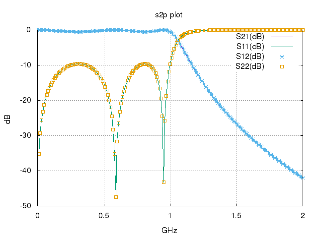
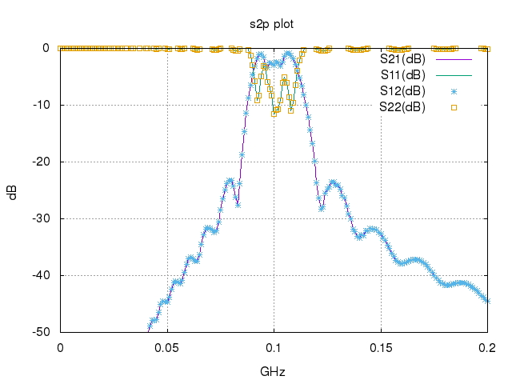

##*FLO*##

FLO is written as an RF circuit simulation tool based on the concept of signal flow.  Different from the conventional way of matrix manipulation, the FLO algorithm is simple and intuitive, sending input to one node and let it transmit and reflect at all the nodes until the steady state is achieved.  





**Progress:**

1. Currently, only L, R, C elements available for passive filter designing.

2. Currently, only two port network can be simulated.  The output results will be written into a .s2p file.

3. Future - add graph GUI in the later stage.

4. Future - add tools to analyze data, such as plotting gain circles.

5. Future - add more element libraries.


**Prerequisite:**

1. Python 2.7.x or 3.x

2. gnuplot for making plot


**Usage:**

Retrieve git repository.
```
git clone https://github.com/antopenrf/FLO.git
```

Then start the program.
```
cd FLO
python sim.py [file_name.sim to run, e.g lpf.sim]

or

pypy sim.py [file to run] ## pypy can speed up the simulation.
```

Here is the output on the terminal.
```
No input file given.  Running demo mode on a low pass filter.


There are 4 nodes, and ground node is not explicitly included.
> node list:  1 2 3 0

The netlist is composed of 5 elements with 2 test ports.
> element 1: l, value 9.78, connects from p1 to p2
> element 2: l, value 9.78, connects from p2 to p3
> element 3: c, value 5.43, connects from p1 to p0
> element 4: c, value 8.09, connects from p2 to p0
> element 5: c, value 5.43, connects from p3 to p0
Simulation done! ./sim_files/lpf.plt generated.

```

All the simulation files are put under sim_files folder.  Two design examples can be found under this folder, lpf.sim and bpf.sim.  If no input sim file is given, the program will run lpf.sim as default.  The output files are one .s2p file and one .plt file.  The .plt file is used to make plot by gnuplot.  Here is the command to make plot.  The output of the plot.sh script is named as output.png.
```
cd sim_files
sh plot.sh (file_name.plt to plot, e.g. lpf.plt)
open output.png
```

**Convergence and benchmark:**

The solver now supports optional convergence-based early stopping inside `sim_Sij()` with these parameters:
- `converge` (default `False`)
- `tol` (default `1e-6`)
- `min_iter` (default `5`)
- `patience` (default `3`)
- `max_iter` (default `None`, falls back to fixed-iteration behavior)
- `check_every` (default `8`)
- `stagnation_checks` (default `4`)
- `stagnation_ratio` (default `0.995`)
- `max_checks` (default `64`)

Adaptive fallback controls in `run()`:
- `auto_disable_convergence` (default `True`)
- `pilot_points` (default `40`)
- `min_converged_ratio` (default `0.2`)

Quick baseline vs converged timing on sample circuits:
```
python bench.py --mode both --cases sim_files/lpf.sim sim_files/bpf.sim --repeats 1 --warmup 0
```

Quick bounded stress run:
```
python bench.py --mode converged --cases sim_files/stress_ladder.sim --max-iter 500 --repeats 1 --warmup 0
```

**Optional C-compiled kernel (experimental):**

Build native module:
```
python setup_fastflow.py build_ext --inplace
```

Use it in benchmark (opt-in):
```
FLO_EXPERIMENTAL_FASTFLOW=1 python bench.py --mode both --cases sim_files/lpf.sim sim_files/bpf.sim --use-fastflow 1
```

By default, `--use-fastflow 0` keeps the pure Python solver path.  
The native path is guarded by `FLO_EXPERIMENTAL_FASTFLOW=1`.

**Python 3 JIT path (Numba, optional):**

Install:
```
python3 -m pip install numba
```

Use in benchmark:
```
python3 bench.py --mode both --cases sim_files/lpf.sim sim_files/bpf.sim --use-numba 1
```

If Numba is not installed, solver automatically falls back to pure Python.

**Benchmark CLI parameters (`bench.py`):**

- `--mode` (default: `both`): `baseline`, `converged`, or both runs.
- `--cases` (default: `sim_files/lpf.sim sim_files/bpf.sim sim_files/stress_ladder.sim`): list of `.sim` files to benchmark.
- `--tol` (default: `1e-6`): convergence threshold.
- `--min-iter` (default: `5`): minimum iterations before convergence check is active.
- `--patience` (default: `3`): consecutive successful checks required to stop.
- `--max-iter` (default: `None`): hard iteration cap override.
- `--check-every` (default: `8`): evaluate convergence every N iterations.
- `--stagnation-checks` (default: `4`): consecutive weak-improvement checks before fallback.
- `--stagnation-ratio` (default: `0.995`): weak-improvement threshold ratio.
- `--max-checks` (default: `64`): max number of convergence checks before fallback (`None` by code path if set accordingly).
- `--auto-disable-convergence` (default: `1`): disable convergence mid-sweep if pilot points show low convergence ratio.
- `--pilot-points` (default: `40`): number of early frequency points to evaluate convergence usefulness.
- `--min-converged-ratio` (default: `0.2`): required converged fraction during pilot window.
- `--phase-floor` (default: `1e-9`): ignore phase delta comparison when both magnitudes are below this floor.
- `--use-fastflow` (default: `0`): enable experimental C extension kernel (requires `FLO_EXPERIMENTAL_FASTFLOW=1`).
- `--use-numba` (default: `0`): enable Python 3 Numba kernel if available.
- `--repeats` (default: `5`): measured runs per case.
- `--warmup` (default: `1`): warmup runs per case before timing.

Recommended stable benchmark command:
```
python3 bench.py --mode both --cases sim_files/lpf.sim sim_files/bpf.sim --repeats 3 --warmup 1
```

**Benchmark presets:**

Quick sanity check (fast, low confidence):
```
python3 bench.py --mode both --cases sim_files/lpf.sim sim_files/bpf.sim --repeats 1 --warmup 0
```

Stable comparison (recommended):
```
python3 bench.py --mode both --cases sim_files/lpf.sim sim_files/bpf.sim --repeats 3 --warmup 1
```

Numba benchmark (Python 3):
```
python3 bench.py --mode both --cases sim_files/lpf.sim sim_files/bpf.sim --use-numba 1 --repeats 3 --warmup 1
```

Experimental C benchmark:
```
FLO_EXPERIMENTAL_FASTFLOW=1 python3 bench.py --mode both --cases sim_files/lpf.sim sim_files/bpf.sim --use-fastflow 1 --repeats 3 --warmup 1
```

**How to run new circuits:**

1. Create a new netlist file under `sim_files/`, for example `sim_files/myfilter.sim`.
2. Use the same syntax as existing examples (`lpf.sim`, `bpf.sim`):
   - element lines (`name node1 node2 type value`)
   - `.Spara` line with test ports
   - `.Freq start stop step` in GHz
   - `.End`
3. Run simulation:
```
python3 sim.py myfilter.sim
```
4. Plot results:
```
sh sim_files/plot.sh sim_files/myfilter.plt
```
5. Benchmark this circuit against others:
```
python3 bench.py --mode both --cases sim_files/myfilter.sim sim_files/lpf.sim sim_files/bpf.sim --repeats 3 --warmup 1
```

Optional with Numba:
```
python3 bench.py --mode both --cases sim_files/myfilter.sim --use-numba 1 --repeats 3 --warmup 1
```
